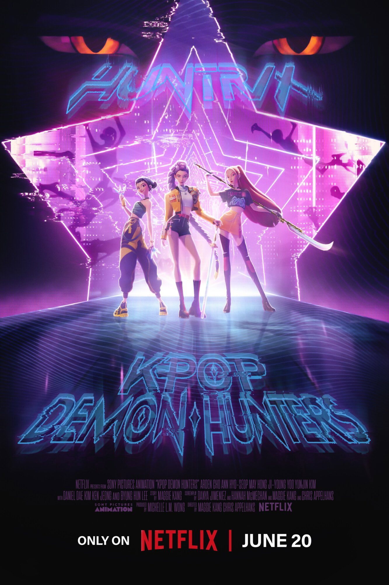
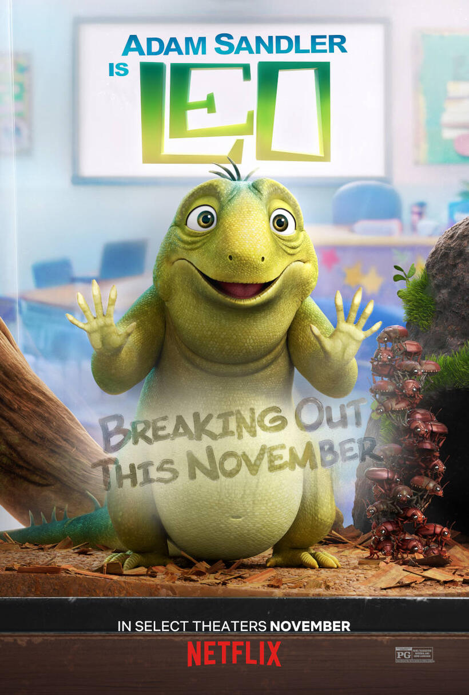
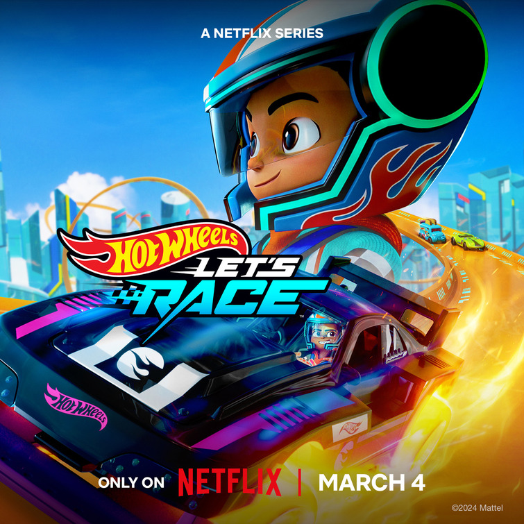
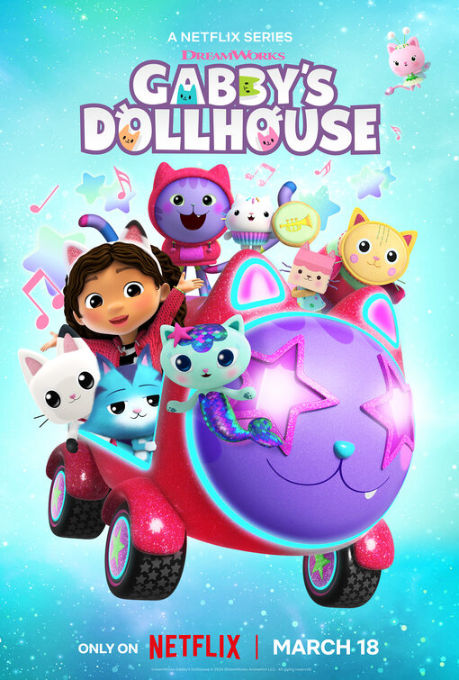
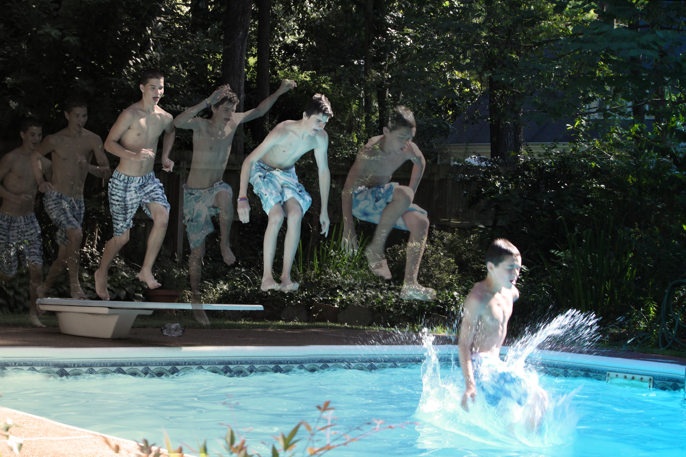
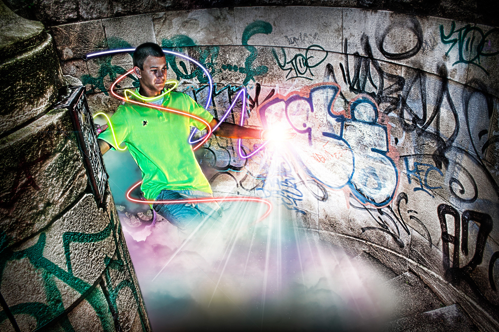
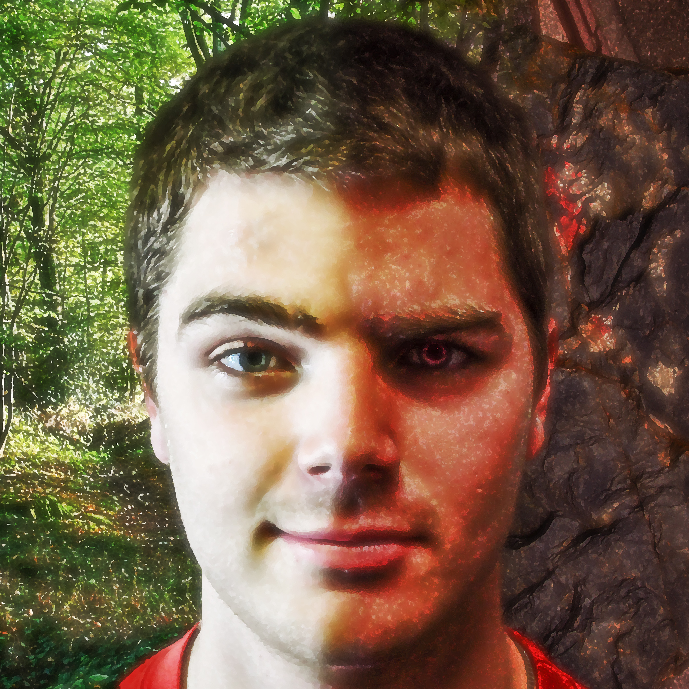
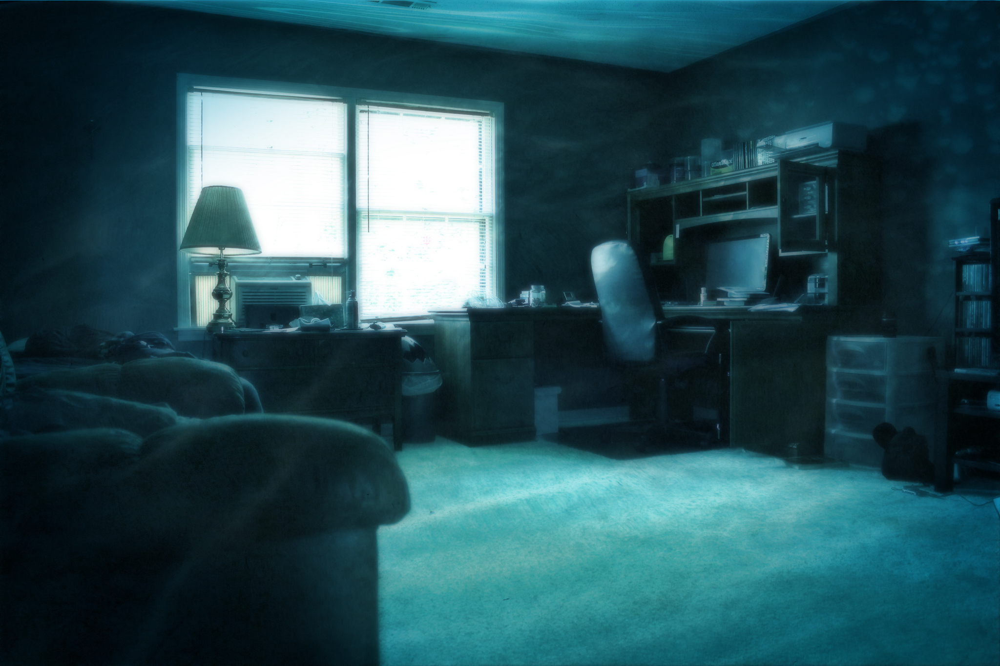
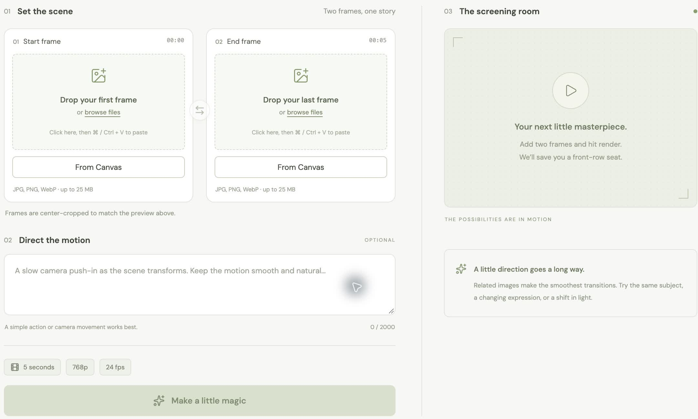

<HudTitle title="How To Make" accent="a Movie" />

STEAMspark2026 — Patrick Hulce

<!--
Welcome! Today we'll look inside a video, talk about stories, and make a movie together.
-->

---
layout: default
label: INTRO
---

<HudTitle title="I work at" accent="Netflix" :stacked="false" />

  
  
  
  

<!--
Who recognizes any of these? I work at Netflix, building tools that help people make movies. Don't imply that I personally worked on these titles.
Poster sources:
KPop Demon Hunters: https://www.themoviedb.org/movie/803796-kpop-demon-hunters/images/posters
Leo: https://www.fandango.com/leo-2023-234291/movie-photos-posters
Hot Wheels Let's Race: https://www.impawards.com/tv/hot_wheels_lets_race.html
Gabby's Dollhouse: https://www.impawards.com/tv/gabbys_dollhouse_ver38.html
-->

---
layout: default
label: INTRO
---

<HudTitle title="Where I" accent="got started" :stacked="false" />

  <HudFrame class="handycam-photo" fit="contain" :scanlines="false"></HudFrame>
  <HudFrame class="weather-frame" fit="contain" :scanlines="false"></HudFrame>
  <HudFrame class="camera-photo" fit="contain" :scanlines="false"></HudFrame>
  <HudFrame class="art-two" fit="contain" :scanlines="false"></HudFrame>
  <HudFrame class="art-five" fit="contain" :scanlines="false"></HudFrame>
  <HudFrame class="portrait-art art-six" fit="contain" :scanlines="false"></HudFrame>
  <HudFrame class="portrait-art art-seven" fit="contain" :scanlines="false"></HudFrame>
  <HudFrame class="art-three" fit="contain" :scanlines="false"></HudFrame>

<!--
About twenty years ago, in high school, I made movies for history and German class. I acted in them too, and recorded them on a camera that used tapes. That's where I got started.
Weather frame and filmmaking history: ../deploy-diffusion/slides.md, Our Inspiration. Handycam photo and digital artwork supplied in imgs/.
-->

---
layout: section
label: VIDEO
---

<HudTitle title="What is" accent="a video?" />

<!--
Let them answer before advancing.
-->

---
layout: default
label: VIDEO
clicks: 2
---

<FrameSequence :step="$clicks" />

<!--
A video is a bunch of pictures changing very quickly.
[click]
Each picture is called a frame. These nine pictures are sampled at evenly spaced points from the looping video, read left to right across each row. There are more frames between these samples.
[click]
When planning or generating a video, we can choose keyframes: important pictures that guide what happens. Here, we're choosing the first and last pictures. The other frames show how we get from one to the other. This is the animation meaning of keyframe, not a lesson about video compression.
Source: the supplied example.mp4; decoded frame indices 0, 6, 12, 18, 24, 29, 35, 41, 47 (approximately 0 to 1.96 seconds).
-->

---
layout: section
label: STORY
---

<HudTitle title="What is" accent="a movie?" />

<!--
Give them a moment to think. What makes a movie different from a few seconds of something moving?
-->

---
layout: section
label: STORY
---

A video that tells a story

<!--
Pictures let us see what happens. The story gives us someone to follow, something they want, and something that happens next. What story should we tell?
-->

---
layout: section
label: STORY
---

  
lots of pictures

  +
  
story

  =
  
movie

---
layout: default
label: MOVIE MAGIC
---

<HudTitle title="Let’s make" accent="a movie!" :stacked="false" />

<a class="demo-url" href="https://hulce.link/SPDA2026" target="_blank" rel="noopener">hulce.link/SPDA2026</a>

<HudFrame class="studio-screenshot" fit="contain" :scanlines="false"></HudFrame>

<!--
Open the link and invite the class to help choose the story and pictures. Leave time for questions while the app works.
Screenshot source: Movie Magic, accessed via https://hulce.link/SPDA2026 in Chrome Canary.
-->

---
layout: section
label: MOVIE MAGIC
---

<HudTitle title="But first, any questions?" />

